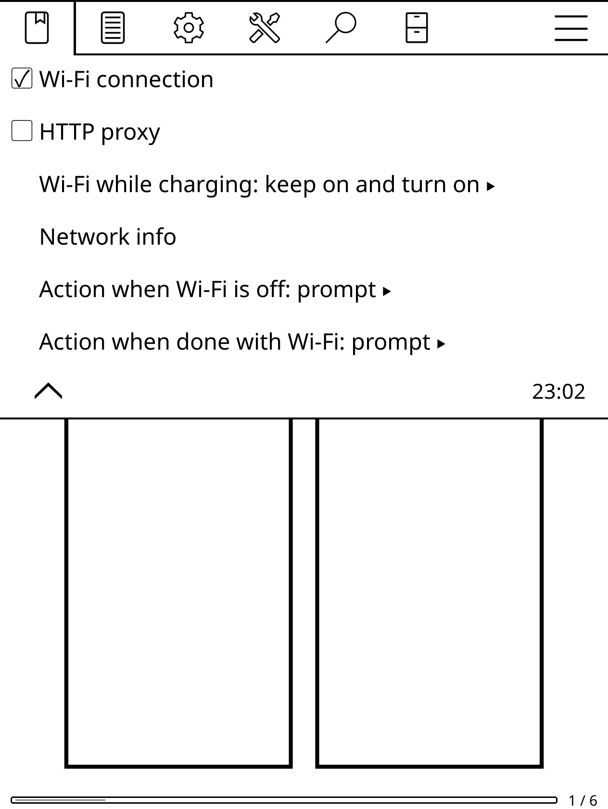
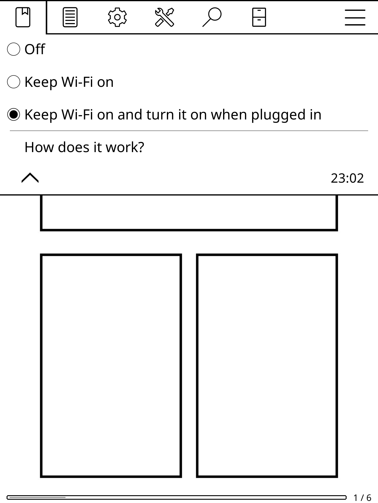
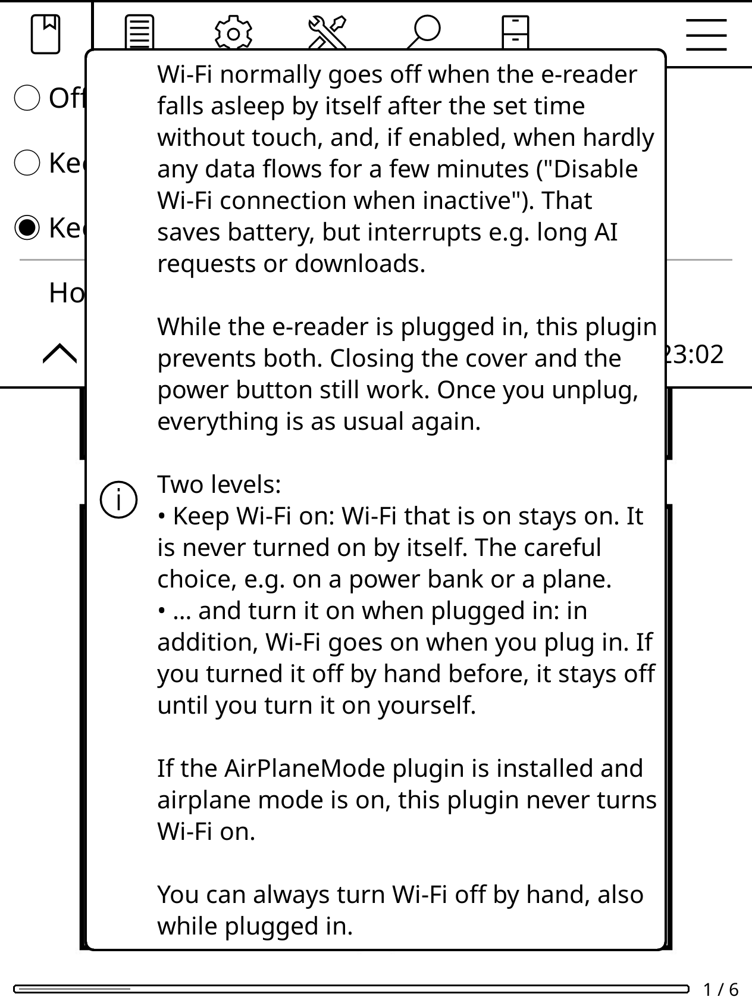

# WLAN beim Laden für KOReader

*English: [README.md](README.md)*

<!-- lang-note -->
*Funktioniert auf **Deutsch und Englisch**: Menüs und Texte richten sich nach der KOReader-Sprache.*

KOReader schaltet das WLAN ab, wenn ein paar Minuten kaum Daten fließen (Einstellung „WLAN-Verbindung bei Inaktivität trennen“). Das spart Akku, unterbricht aber z. B. lange KI-Anfragen oder Downloads. Solange der E-Reader am Ladekabel hängt, verhindert dieses Plugin das. Auf Wunsch schaltet es das WLAN beim Einstecken auch ein.

## Bildschirmfotos

*Die Bildschirmfotos zeigen die englische Oberfläche; in einem deutschen KOReader sind die Texte deutsch.*

<table>
<tr><td align="center" valign="top" width="33%"> Netzwerk-Menü mit dem neuen Eintrag</td><td align="center" valign="top" width="33%"> Die drei Stufen</td><td align="center" valign="top" width="33%"> Hilfetext</td></tr>
</table>

## Was es kann

Menü: Zahnrad → Netzwerk → **„WLAN beim Laden“**, direkt unter „WLAN-Verbindung bei Inaktivität trennen“. Drei Stufen:

- **Aus:** KOReader verhält sich wie immer.
- **WLAN anlassen** (Standard): Am Ladekabel bleibt ein eingeschaltetes WLAN an. Von selbst eingeschaltet wird es nie. Die vorsichtige Wahl, z. B. an der Powerbank oder im Flugzeug.
- **WLAN anlassen und beim Einstecken einschalten:** Zusätzlich geht das WLAN kurz nach dem Einstecken an. Gut für zu Hause.

Nie von selbst eingeschaltet wird das WLAN,
- wenn du es von Hand ausgeschaltet hast (bis du es selbst wieder einschaltest),
- wenn das Plugin [AirPlaneMode](https://github.com/kodermike/airplanemode.koplugin) installiert und der Flugmodus an ist.

Ziehst du das Kabel ab, gilt wieder die normale Regel. Ausschalten von Hand geht immer.

## Installieren

1. Die ZIP-Datei unter [Releases](../../releases) herunterladen und entpacken, oder dieses Projekt herunterladen.
2. Den Ordner **`wifiwhilecharging.koplugin`** in KOReaders `plugins`-Ordner kopieren. Auf dem Kobo ist das `.adds/koreader/plugins/`.
3. KOReader neu starten.

## Wie es funktioniert

Am Ladekabel schläft der E-Reader nicht von selbst ein (dabei würde KOReader das WLAN ausschalten). Dafür nutzt das Plugin KOReaders eigenen Schalter. Hülle zuklappen und Einschaltknopf wirken weiter.

Außerdem zählt KOReader alle paar Minuten die gesendeten Datenpakete. Am Ladekabel meldet das Plugin dort „keine Messung“, dann überspringt KOReader das Abschalten. Diesen Fall sieht KOReader selbst vor. Ändert ein KOReader-Update diese interne Stelle, hängt sich das Plugin nicht ein und zeigt im Menü einen Hinweis, statt abzustürzen. Dann bitte ein [Issue](../../issues) anlegen.

## Getestet auf

Kobo Libra Colour mit KOReader 2026.07.1 und ZenOS.

## Wer das gemacht hat

Der Code wurde vollständig von **Claude** geschrieben, einer KI von Anthropic (in Claude Code). Der Inhaber dieses Projekts hatte die Idee, hat das Plugin auf dem Kobo getestet und Rückmeldungen gegeben, aber keinen Code geschrieben.

Es gibt keine Garantie und keinen festen Support. Fehlermeldungen sind als [Issue](../../issues) willkommen. Bitte die `crash.log` aus dem KOReader-Ordner anhängen.

## Weitere Plugins

- [Comic Display](https://github.com/Akrota/koreader-comic-display): Refresh gegen Ghosting, dunkle Ränder und Uhr für Comics
- [Levels / Tonwerte](https://github.com/Akrota/koreader-comic-levels): Tonwertkurve für Comics
- [Comic Panel Zoom](https://github.com/Akrota/koreader-comic-panel-zoom): Panel-für-Panel-Ansicht (Fork von JorgeTheFox)
- [Comic Dual Page](https://github.com/Akrota/koreader-comic-dual-page): Doppelseiten mit Erkennung (Fork von KORComic)
- [CBZ Converter](https://github.com/Akrota/koreader-cbz-converter): Comics, PDF und EPUB auf dem Gerät in CBZ umwandeln
- [Folder to series](https://github.com/Akrota/koreader-folder-to-series): Comic-Ordner zu Reihen mit Bandnummern
- [Drive Library](https://github.com/Akrota/koreader-drive-library): Google Drive als Cloud-Bibliothek
- [Story Recall](https://github.com/Akrota/koreader-story-recall): Spoilerfreier KI-Rückblick auf Bücher
- [Guitar Tab Reader](https://github.com/Akrota/koreader-guitar-tab-reader): Gitarren-Tabs und Chords für E-Ink
- [Zen page browser gesture](https://github.com/Akrota/koreader-zen-page-browser-gesture): Geste für den ZenOS-Seitenbrowser

## Lizenz

[MIT](LICENSE)
