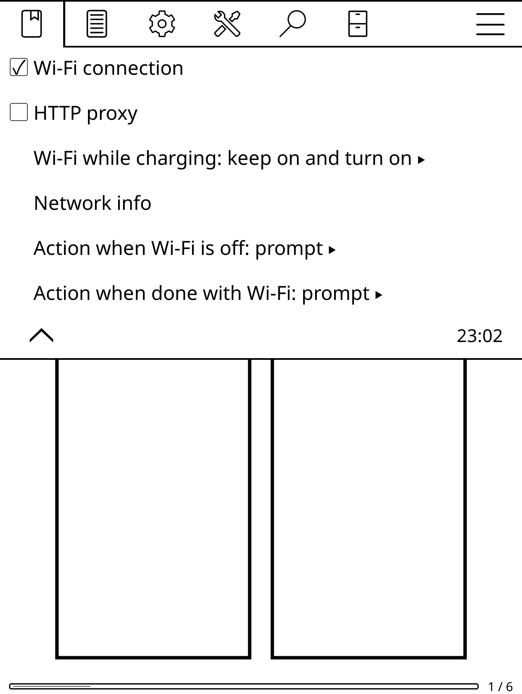
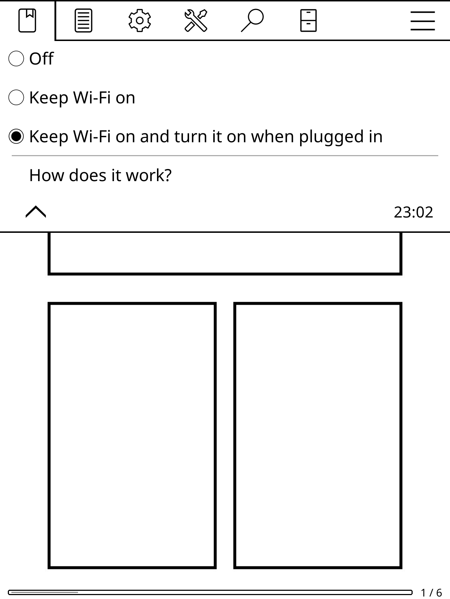
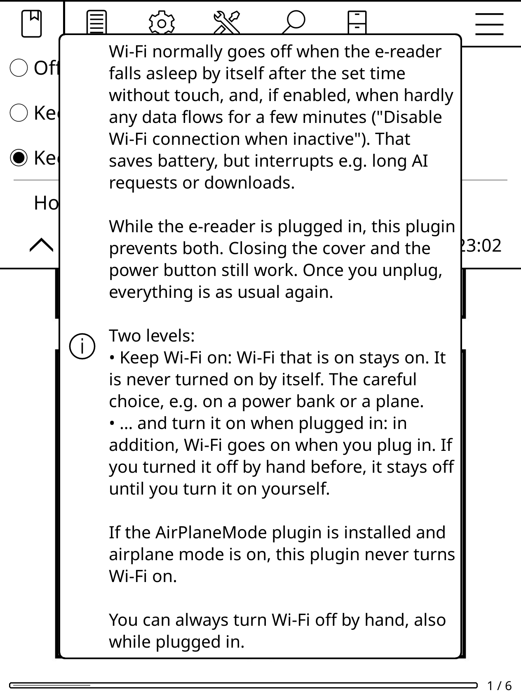

# Wi-Fi while charging for KOReader

*Deutsch: [README.de.md](README.de.md)*

<!-- lang-note -->
*Works in **English and German**: menus and texts follow KOReader's language. A German description is at the bottom of this page.*

KOReader turns Wi-Fi off when hardly any data flows for a few minutes (setting "Disable Wi-Fi connection when inactive"). That saves battery, but interrupts e.g. long AI requests or downloads. While the e-reader is plugged in, this plugin prevents that. If you like, it also turns Wi-Fi on when you plug it in.

## Screenshots

*The screenshots show the English interface; in a German KOReader the texts are German.*

<table>
<tr><td align="center" valign="top" width="33%"> Network menu with the new entry</td><td align="center" valign="top" width="33%"> The three modes</td><td align="center" valign="top" width="33%"> Help text</td></tr>
</table>

## Features

Menu: gear → Network → **"Wi-Fi while charging"**, right below "Disable Wi-Fi connection when inactive". Three levels:

- **Off:** KOReader behaves as usual.
- **Keep Wi-Fi on** (default): while plugged in, Wi-Fi that is on stays on. It is never turned on by itself. The careful choice, e.g. on a power bank or a plane.
- **Keep Wi-Fi on and turn it on when plugged in:** in addition, Wi-Fi goes on shortly after you plug in. Good for home.

Wi-Fi is never turned on by itself
- if you turned it off by hand (until you turn it on yourself),
- if the [AirPlaneMode](https://github.com/kodermike/airplanemode.koplugin) plugin is installed and airplane mode is on.

Once you unplug, the normal rule applies again. You can always turn Wi-Fi off by hand.

## Installation

1. Download and unpack the ZIP file from [Releases](../../releases), or download this project.
2. Copy the folder **`wifiwhilecharging.koplugin`** into KOReader's `plugins` folder. On a Kobo that is `.adds/koreader/plugins/`.
3. Restart KOReader.

## How it works

While plugged in, the e-reader does not fall asleep by itself (KOReader would turn Wi-Fi off then). The plugin uses KOReader's own switch for that. Closing the cover and the power button still work.

Also, every few minutes KOReader counts the data packets sent. While plugged in, the plugin reports "no reading" there, and KOReader skips turning Wi-Fi off. KOReader itself handles that case. If a KOReader update changes this internal spot, the plugin does not hook in and shows a note in its menu instead of crashing. Please open an [issue](../../issues) then.

## Tested on

Kobo Libra Colour with KOReader 2026.07.1 and ZenOS.

## Who made this

The code was written entirely by **Claude**, an AI by Anthropic (in Claude Code). The owner of this project had the idea, tested the plugin on the Kobo and gave feedback, but did not write any code.

There is no warranty and no fixed support. Bug reports are welcome as an [issue](../../issues). Please attach the `crash.log` from the KOReader folder.

## More plugins

- [Comic Display](https://github.com/Akrota/koreader-comic-display): Refresh against ghosting, dark borders and a clock for comics
- [Levels / Tonwerte](https://github.com/Akrota/koreader-comic-levels): Tone curve for comics
- [Comic Panel Zoom](https://github.com/Akrota/koreader-comic-panel-zoom): Panel-by-panel view (fork of JorgeTheFox's plugin)
- [Comic Dual Page](https://github.com/Akrota/koreader-comic-dual-page): Double pages with detection (fork of KORComic)
- [CBZ Converter](https://github.com/Akrota/koreader-cbz-converter): Convert comics, PDF and EPUB to CBZ on the device
- [Folder to series](https://github.com/Akrota/koreader-folder-to-series): Comic folders to series with volume numbers
- [Drive Library](https://github.com/Akrota/koreader-drive-library): Google Drive as a cloud library
- [Story Recall](https://github.com/Akrota/koreader-story-recall): Spoiler-free AI recap for books
- [Guitar Tab Reader](https://github.com/Akrota/koreader-guitar-tab-reader): Guitar tabs and chords for e-ink
- [Zen page browser gesture](https://github.com/Akrota/koreader-zen-page-browser-gesture): Gesture for the ZenOS page browser

## License

[MIT](LICENSE)

---

## Deutsch (Kurzbeschreibung)

KOReader schaltet das WLAN ab, wenn ein paar Minuten kaum Daten fließen (Einstellung „WLAN-Verbindung bei Inaktivität trennen“). Das spart Akku, unterbricht aber z. B. lange KI-Anfragen oder Downloads. Solange der E-Reader am Ladekabel hängt, verhindert dieses Plugin das. Auf Wunsch schaltet es das WLAN beim Einstecken auch ein.

### Was es kann

Menü: Zahnrad → Netzwerk → **„WLAN beim Laden“**, direkt unter „WLAN-Verbindung bei Inaktivität trennen“. Drei Stufen:

- **Aus:** KOReader verhält sich wie immer.
- **WLAN anlassen** (Standard): Am Ladekabel bleibt ein eingeschaltetes WLAN an. Von selbst eingeschaltet wird es nie. Die vorsichtige Wahl, z. B. an der Powerbank oder im Flugzeug.
- **WLAN anlassen und beim Einstecken einschalten:** Zusätzlich geht das WLAN kurz nach dem Einstecken an. Gut für zu Hause.

Nie von selbst eingeschaltet wird das WLAN,
- wenn du es von Hand ausgeschaltet hast (bis du es selbst wieder einschaltest),
- wenn das Plugin [AirPlaneMode](https://github.com/kodermike/airplanemode.koplugin) installiert und der Flugmodus an ist.

Ziehst du das Kabel ab, gilt wieder die normale Regel. Ausschalten von Hand geht immer.

### Wie es funktioniert

Am Ladekabel schläft der E-Reader nicht von selbst ein (dabei würde KOReader das WLAN ausschalten). Dafür nutzt das Plugin KOReaders eigenen Schalter. Hülle zuklappen und Einschaltknopf wirken weiter.

Außerdem zählt KOReader alle paar Minuten die gesendeten Datenpakete. Am Ladekabel meldet das Plugin dort „keine Messung“, dann überspringt KOReader das Abschalten. Diesen Fall sieht KOReader selbst vor. Ändert ein KOReader-Update diese interne Stelle, hängt sich das Plugin nicht ein und zeigt im Menü einen Hinweis, statt abzustürzen. Dann bitte ein [Issue](../../issues) anlegen.

Die ausführliche deutsche Anleitung steht in der [README.de.md](README.de.md).
